<picture>
  <source media="(prefers-color-scheme: light)" srcset="assets/hero-light.svg">
  
</picture>

  <b>I watch systems for a living, and build my own after hours.</b> 
  <i>Construindo as ideias que antes não cabiam no tempo.</i>

### `▸ monitored assets`

<picture>
  <source media="(prefers-color-scheme: light)" srcset="assets/hosts-light.svg">
  
</picture>

<!-- links:start -->

live endpoints: <a href="https://prova-ai-lp.vercel.app"><code>prova.ai</code></a> · <a href="https://amandavidal.adv.br"><code>amandavidal.adv.br</code></a> most repos are private (client and product work). Ask me for a walkthrough.

<!-- links:end -->

### `▸ event stream`

<picture>
  <source media="(prefers-color-scheme: light)" srcset="assets/feed-light.svg">
  
</picture>

### `▸ installed stack`

<picture>
  <source media="(prefers-color-scheme: light)" srcset="assets/stack-light.svg">
  
</picture>

### `▸ open a channel`

  
  

Panels are SVGs rendered daily by <a href=".github/workflows/render.yml">a GitHub Action</a> from <a href="data/projects.json"><code>data/projects.json</code></a> and public activity. No third-party stats service.
